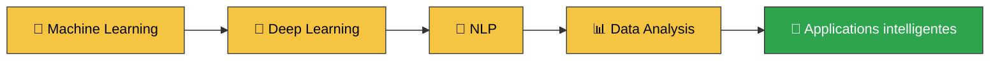

<!-- ===================================================== -->
<!--                  BANNIÈRE ANIMÉE                      -->
<!-- ===================================================== -->

<!-- Texte qui s'écrit tout seul -->

 

<em>Je conçois des solutions basées sur les données, j'explore l'Intelligence Artificielle et je transforme les données en solutions utiles.</em>

  

<!-- Compteur de visites -->

 

<!-- ===================================================== -->
<!--                  LIENS CLIQUABLES                     -->
<!-- ===================================================== -->

<!-- ===================================================== -->
<!--                     À PROPOS                          -->
<!-- ===================================================== -->

##  À propos de moi

Je suis une <strong>Data Analyst et développeuse en Intelligence Artificielle</strong>,
passionnée par les données, le Machine Learning et le développement de solutions intelligentes.
  
J'aime analyser les données, résoudre des problèmes et découvrir continuellement
de nouvelles technologies afin de créer des solutions <strong>utiles et innovantes</strong>.

| 📊 Analyse de données | 🤖 Intelligence Artificielle | 🧠 Machine Learning | 🔬 Deep Learning |
|:---:|:---:|:---:|:---:|
| **📝 NLP** | **🗄️ Bases de données** | **💻 Développement logiciel** | **🧩 Modélisation UML / Merise** |

 

> ✨ **Construire. Apprendre. Expérimenter. Innover.** ✨

<!-- ===================================================== -->
<!--                  TECHNOLOGIES                         -->
<!-- ===================================================== -->

## 🛠️ Technologies & compétences

### 🤖 Intelligence Artificielle & Data

<b>Python · Pandas · NumPy · Matplotlib · Seaborn · Scikit-learn · TensorFlow</b>
 
Machine Learning · Deep Learning · NLP · Analyse de données

  

### 🌐 Développement Web

  

### 📱 Mobile & Backend

  

### 🗄️ Bases de données

<b>SQL · MySQL · MongoDB · phpMyAdmin · Firestore</b>

  

### 🧩 Modélisation & développement logiciel

<b>Programmation Orientée Objet · UML · Merise</b>
 
Modélisation des systèmes informatiques

  

### ⚙️ Outils & environnements

<!-- ===================================================== -->
<!--                      PROJETS                          -->
<!-- ===================================================== -->

## 🚀 Quelques projets

<table align="center">
<tr>
<td width="50%" valign="top">

### 🖼️ Préparation de données images

Nettoyage et préparation d'un dataset pour la **classification d'images**.

- 🔍 Détection des images corrompues
- 🧹 Nettoyage
- 📐 Redimensionnement
- 🎨 Conversion RGB
- 🔢 Normalisation
- ♻️ Détection des doublons

</td>
<td width="50%" valign="top">

### 📝 Préparation de données textuelles — NLP

Préparation d'un corpus de commentaires pour la **classification de sentiments**.

- 🔍 Exploration
- 🧹 Nettoyage
- 🔤 Normalisation
- ✂️ Tokenisation
- 📊 Bag of Words
- 📈 TF-IDF · 🔠 Unigrams & Bigrams

</td>
</tr>
</table>

<!-- ===================================================== -->
<!--                   STATISTIQUES                        -->
<!-- ===================================================== -->

## 📊 Mes statistiques GitHub

 

  

  

<!-- ===================================================== -->
<!--                 CE QUE J'APPRENDS                     -->
<!-- ===================================================== -->

## 🧠 Ce que j'apprends actuellement

<!-- ===================================================== -->
<!--           SNAKE (nécessite le workflow GitHub)        -->
<!-- ===================================================== -->

<picture>
  <source media="(prefers-color-scheme: dark)" srcset="https://raw.githubusercontent.com/binetouwahab/binetouwahab/output/github-snake-dark.svg" />
  <source media="(prefers-color-scheme: light)" srcset="https://raw.githubusercontent.com/binetouwahab/binetouwahab/output/github-snake.svg" />
  
</picture>

  

### 💬 Parlons data, IA et innovation !

<!-- ===================================================== -->
<!--                  PIED DE PAGE ANIMÉ                   -->
<!-- ===================================================== -->

